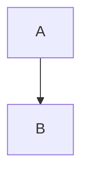

# REFERENCE_EXTENDED_TOP

Extended syntax: footnotes[^1], wiki links [[Some Page]], HTML comments, and callouts.

[^1]: The footnote text.

<!-- an HTML comment that should not render -->

> [!NOTE]
> A note callout.

> [!WARNING]
> A warning callout.

Term
: Definition list item.

## Emanote

Highlighted ==text== and <kbd>Ctrl</kbd>+<kbd>C</kbd>.



```json
{ "key": "value", "list": [1, 2, 3] }
```

$$
E = mc^2
$$

REFERENCE_EXTENDED_BOTTOM
